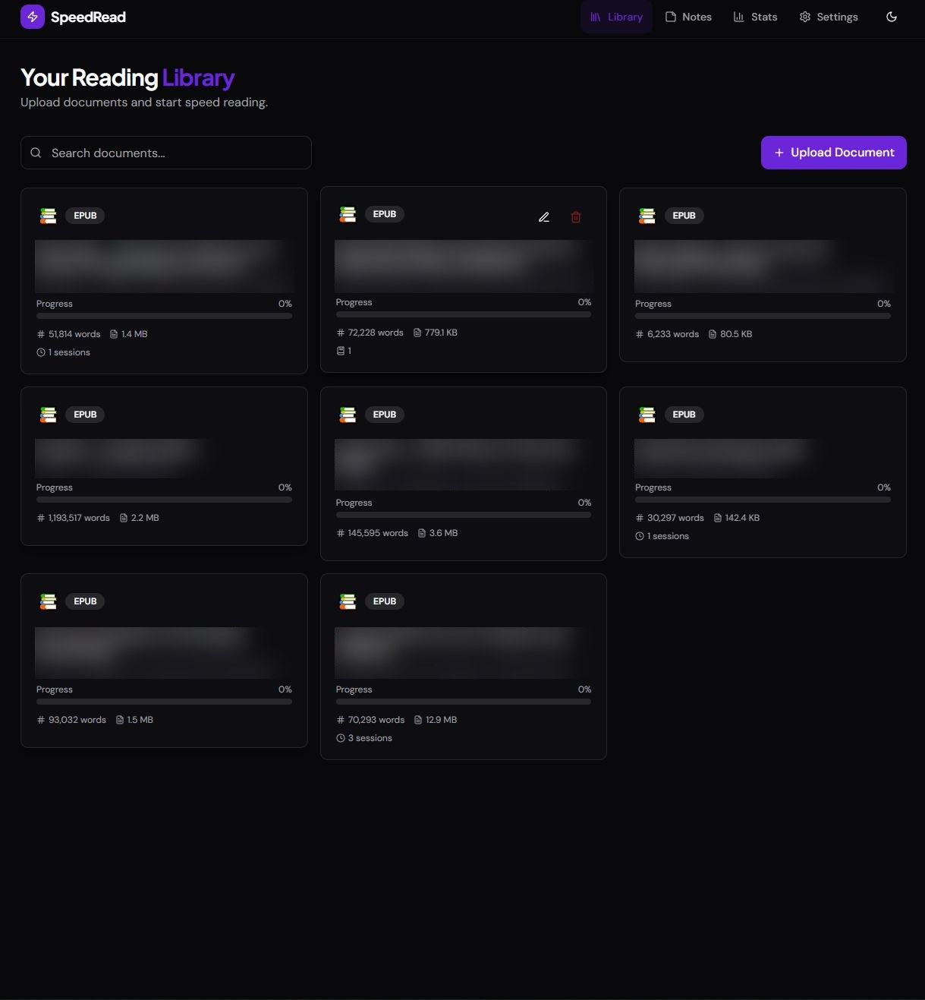
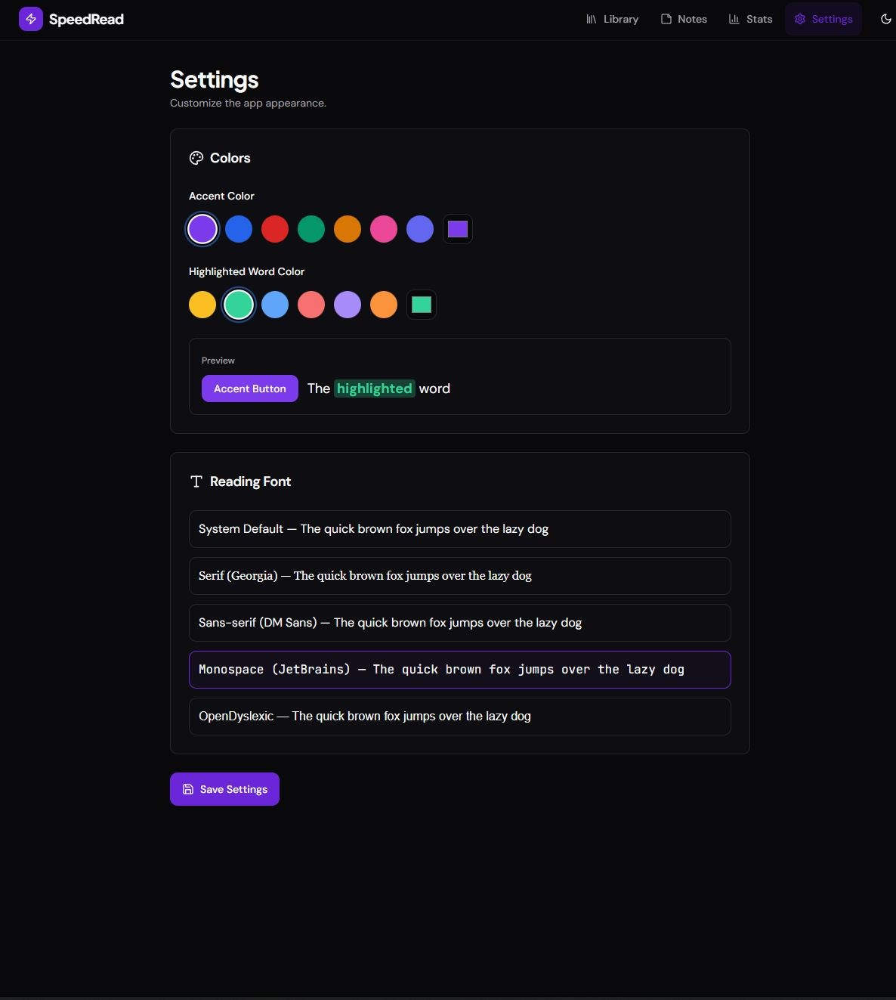

# SpeedReader

A self-hosted speed-reading web app. Upload a book or document and read it in several modes, including RSVP (one word at a time at a set speed), while the app keeps your place, notes, bookmarks and reading statistics.

> **Personal project, built with AI assistance.** The first version was generated with Abacus.ai's DeepAgent. I deploy, run and maintain it on my own home server and keep it as a hands-on example of working with AI-generated code in a real deployment.

## Screenshots
| Library (book titles blurred) | Reader (RSVP / chunking) | Settings |
|---|---|---|
|  |  |  |

## What it does
- **Library** of uploaded documents (from a file or a URL).
- **Five reading modes:** normal, chunk, highlight, guided and RSVP.
- **Bookmarks, annotations, notes (with categories) and flashcards.**
- **Sessions and statistics** (reading speed over time, charts).
- **Settings** for accent and highlight colours, reading font and light/dark theme.
- Text extraction from plain text, Markdown, HTML, DOCX, PDF and EPUB, done in the browser (pdf.js, epub.js, mammoth).

## Stack
Next.js 14 (App Router), React 18, TypeScript, Tailwind CSS with shadcn/ui, Prisma 6 with PostgreSQL, NextAuth. Documents are stored on the server's filesystem.

## How it runs
On my homelab it runs as a Node process under pm2 inside a Proxmox LXC container, with a local PostgreSQL database, books mounted from a separate disk, and a Cloudflare Tunnel in front. Self-hosting steps are in [DEPLOYMENT.md](DEPLOYMENT.md). Updates follow a back-up, stop, replace, migrate, restart, verify routine with a rollback path.

## Things to know
- Configuration is in environment variables; copy `.env.example` to `.env`. No secrets are committed.
- Parsing happens in the browser, so no cloud service is needed to import books. One leftover server route (`app/api/documents/[id]/parse`) still calls Abacus.ai's hosted API for PDFs; nothing in the interface uses it, and it needs `ABACUSAI_API_KEY`. The root layout also loads a script from Abacus.ai (`app/layout.tsx`). Both can be removed for a fully self-contained build.
- There is no automated test suite yet.

## Licence
MIT. See [LICENSE](LICENSE).
